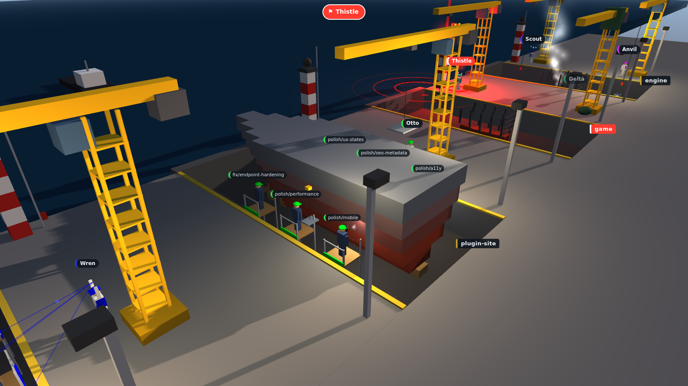
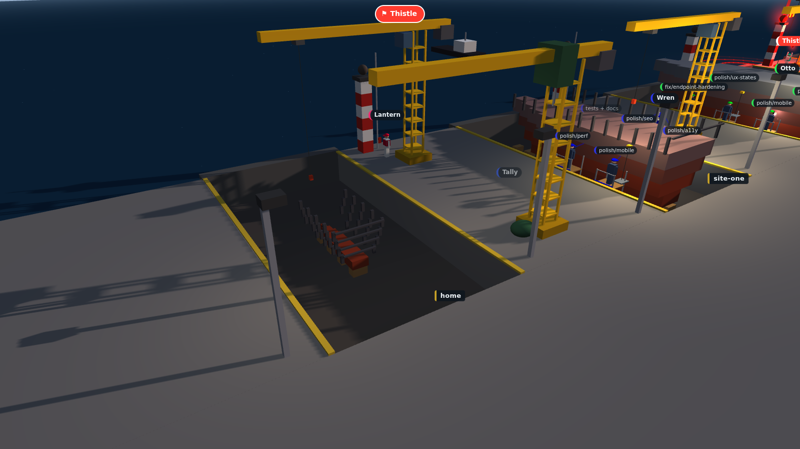
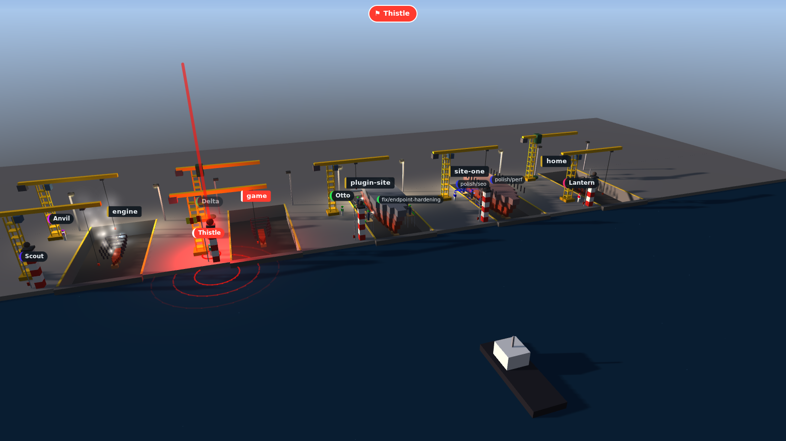
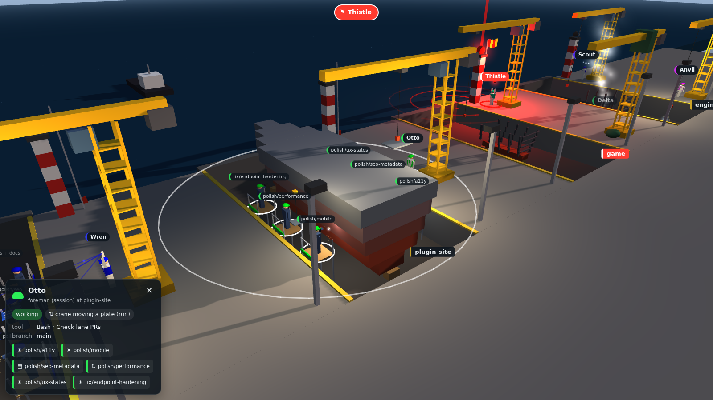

# agentviz-shipyard

Claude Code sessions and their subagents drawn as a shipyard along a harbour,
on the [Strata](https://github.com/Preponderous-Software/strata) web kit.
Part of [agentviz](https://github.com/dmccoystephenson/agentviz): one of ten
ways to watch the same feed.


*The whole yard (demo feed). Five repos, five dry docks. The red beam and
banner at the top: Thistle, at the `game` dock, is waiting on you.*

Every repo gets a **dry dock** with a hull under construction; the hull grows
with the total tool calls of the subagents working there. Every session is a
**foreman** on the quay beside the dock, with a **crane**. Its subagents are
**welders** on the scaffolding round the hull, wearing their foreman's
hard-hat colour, each scaffold bay labelled with its lane.

## What each visual means

| You see | It means |
|---|---|
| A dry dock with a hull | a place (repo); bigger, more plated hull = more subagent tool calls there |
| Foreman in a white shirt and coloured vest + crane | a session (lead); name label in its colour |
| Welder on scaffolding in the same hat colour; toe-board in that colour | a subagent of that foreman; label = its lane |
| Welding sparks and flashing blue-white light | `edit` (Edit, Write) |
| Crane trolley carrying a steel plate (welder: a chain hoist lifting a plate) | `run` (Bash, Monitor) |
| Holding a blue blueprint | `read` (Read, Grep, Glob) |
| Blinking signal lamp, dots streaming to the ship offshore (whose lamp answers) | `web` (WebSearch, WebFetch) |
| Arms waving, coloured lines with dots running to each welder | `delegate` (Agent; or busy with working subagents) |
| Pacing the quay, three thought dots circling the head | `think` (busy, no recent tool) |
| Tapping a hammer | `other` tool (MCP, Skill, ...) |
| **Foghorn tower lamp flashing red, flag raised, red beam into the sky, ripples on the water, red pulsing dot over the foreman, red banner at the top of the page** | **`waiting`: the session needs you** |
| Floodlights low, crane still, foreman standing | `idle` |
| Tarp over the crane cab and a tarped heap on the quay (whole dock tarped when every session there is gone) | `offline` |
| Grey smoke rising from the hull | `stalled` (busy but silent for over 5 minutes) |
| Welder sitting on the scaffold edge, legs dangling | resting subagent (quiet for over 2 minutes) |

Tap or click anyone to select them: a panel (a bottom sheet on a phone) shows
name, state, action, tool label, branch and the crew; tap a crew chip to jump
to that welder or back to its foreman. Tap the red banner to fly to the
session that needs you.

## Close-ups



*A lead and its crew: Otto's six subagents in green hats on the scaffolding
round the `plugin-site` hull, welding, hoisting, reading.*


*`waiting`: Thistle needs the owner. Foghorn lamp, raised flag, beam, ripples
and a red marker over the foreman, all at once.*



*`idle` and `offline`: Lantern stands by under low floodlights; Tally has gone,
so its crane cab and spot on the quay are tarped.*


*`stalled`: Scout has been busy without writing anything for over five
minutes, so the `engine` hull smokes. Anvil, beside it, is welding.*


*A resting subagent, selected: Wren's `tests + docs` welder sits down on its
scaffold bay while the other lanes weld and read. Wren waves her crews on.*

## Other angles



*From the harbour, looking inland past the ship the signal lamps talk to.*


*From above: docks side by side, foremen on the quays to the left of each.*

## Panel and phone



*Desktop: Otto selected; his welders are ringed too.*


*Phone (390 x 844, DPR 3): touch orbit and pinch, bottom sheet open on Wren.*

## Motion


*Five seconds of the demo yard: sparks, cranes, lamps and Wren waving her
crews to their sections.*

All images come from the synthetic demo feed (`--fixture`), never from live
sessions. Regenerate them with `node tests/screenshots.cjs` (below).

## Run

```bash
python3 -m vendor.agentfeed serve --web web --port 8848             # live sessions on this machine
python3 -m vendor.agentfeed serve --web web --port 8848 --fixture   # demo feed
```

Open <http://127.0.0.1:8848/> (`?fixture=1` shows the demo feed from a live
server, `?fps=1` the kit's frame stats, `?view=sea` or `?view=top` another
starting angle). The server binds 127.0.0.1 only. The page polls
`/api/agents` every 2 s, keys everything by id and eases figures to their new
places.

## Build

The built engine (`web/shipyard-engine.js|.wasm`) and the kit scripts are
committed, so running needs only Python. To rebuild after changing
`scene/main.cpp` (Strata 0.10.0, emsdk 6.0.11; downloads into `.strata/`):

```bash
scene/build.sh
```

## Test

```bash
python3 -m unittest discover -s tests                                  # page, assets, feed
NODE_PATH=/root/arcade-watch/node_modules node tests/smoke.cjs         # headless Chromium smoke
NODE_PATH=/root/arcade-watch/node_modules node tests/screenshots.cjs   # regenerate docs/media
```

The browser scripts start their own fixture server on port 8948 and need
Playwright (any `node_modules` with `playwright` works for `NODE_PATH`).

## Layout

| Path | What |
|---|---|
| `scene/main.cpp` | the Strata scene: draws docks, hulls, cranes, figures and effects from rows the page hands it |
| `scene/kit.conf`, `scene/build.sh` | the web kit build |
| `web/index.html`, `web/shipyard.js` | the page: polling, layout, easing, labels, picking, panel |
| `vendor/agentfeed/` | the shared feed, vendored from agentviz (do not edit) |
| `tests/` | unittest, smoke test, screenshot script |
