# agentviz-shipyard

Claude Code sessions and their subagents drawn as a shipyard along a harbour,
on the [Strata](https://github.com/Preponderous-Software/strata) web kit.
Part of [agentviz](https://github.com/dmccoystephenson/agentviz): one of ten
ways to watch the same feed.

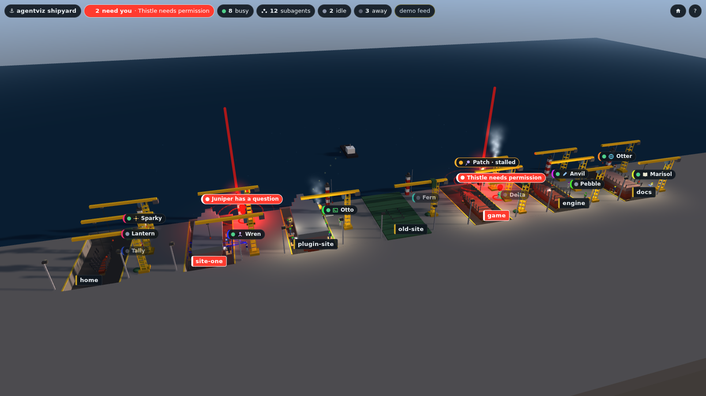

*The whole yard (demo feed). Seven repos, seven dry docks. The red beams, the
red labels and the chip in the top bar: Juniper (a question) and Thistle (a
permission prompt) are waiting on you.*

Every repo gets a **dry dock** with a hull under construction; the hull is
longer and plated higher the more tool calls the repo has seen. Every session
is a **foreman** on the quay beside the dock, with a **crane**. Its subagents
are **welders** on the scaffolding round the hull, wearing their foreman's
hard-hat colour, each scaffold bay labelled with its lane.

## Run

Needs Python 3.8 or newer and nothing else:

```bash
git clone https://github.com/dmccoystephenson/agentviz-shipyard
cd agentviz-shipyard
python3 -m vendor.agentfeed serve --web web --port 8848            # your live sessions
python3 -m vendor.agentfeed serve --web web --port 8848 --fixture  # the demo feed
```

Open <http://127.0.0.1:8848/> (the server binds 127.0.0.1 only and refuses
non-local `Host` headers). Live mode reads your Claude Code session files
under `~/.claude` and shows session names, states, git branches, tool names
and short labels (a file's basename, a Bash command's own description, a web
host, a subagent's description), never file contents, commands or prompts;
see the agentviz [SECURITY.md](https://github.com/dmccoystephenson/agentviz/blob/main/SECURITY.md).
Query options: `?fixture=1` (demo feed against a live server), `?view=sea` or
`?view=top` (another starting angle), `?fps=1` (frame stats),
`?quality=0|1|2`.

Each foreman's label carries the icon of what he is doing (edit, run, read,
web, delegate, think); a stalled foreman's or welder's label turns amber and
stays up even from afar. Tap or click a foreman or a welder for its card (a
bottom sheet on a phone, with the camera sliding so what you tapped stays in
view above it; swipe it down or tap the cross to close): name, state,
action, what it is doing, branch, place, tool calls, the dock's hull and its
crew; tap a crew chip to fly to that welder, where its card shows its own
branch. The red
**need you** chip names who is waiting and why (a question, or a permission
prompt), flies to that foreman and cycles through them; the house button
shows the whole yard again (on a phone held upright, looking along the
harbour so every dock fits); **?** opens the legend. Labels never sit under
the top bar, the card or the legend. If the feed stops
answering, a banner says so and the last snapshot stays; with no sessions at
all, a hint says how to start. Drag to orbit, right-drag or two fingers to
pan, wheel or pinch to zoom.

## What you are looking at

| You see | It means | Close-up |
|---|---|---|
| A dry dock with a hull on keel blocks | a **place** (working-directory basename) | [hero](docs/media/hero.png) |
| How long the hull is and how high it is plated (bare ribs above) | how many tool calls the place has seen (its `toolCount`) | [closeup-lead](docs/media/closeup-lead.png) |
| Foreman in a white shirt and a coloured vest, beside a crane | a **session**; its colour edges its label, whose icon is its action | [closeup-lead](docs/media/closeup-lead.png) |
| Welder on a scaffold bay in the same hat colour, toe-board in that colour | a **subagent** of that foreman; label = its lane | [closeup-lead](docs/media/closeup-lead.png) |
| Welding sparks and a flickering blue-white light | action `edit` | [motion.gif](docs/media/motion.gif) |
| Crane trolley carrying a steel plate (a welder: a chain hoist lifting one) | action `run` | [closeup-lead](docs/media/closeup-lead.png) |
| Holding a blue blueprint | action `read` | [closeup-lead](docs/media/closeup-lead.png) |
| Signal lamp blinking, dots streaming to the ship offshore, whose lamp answers | action `web` | [motion.gif](docs/media/motion.gif) |
| Arms waving, lines in the foreman's colour running to each welder | action `delegate` | [motion.gif](docs/media/motion.gif) |
| Pacing the quay, three thought dots circling the head | action `think` | |
| Tapping a hammer | action `other` | [closeup-idle-offline](docs/media/closeup-idle-offline.png) |
| A white flash and a ring of sparks at the work point | a **new tool call** (the session's `lastToolAt` moved, or a subagent's `toolCount` rose) | [closeup-tool-call](docs/media/closeup-tool-call.png) |
| **Foghorn lamp flashing red, flag raised, red beam into the sky, ripples on the water, the foreman waving, a red label and the chip in the top bar** | state **`waiting`**: the session needs you | [closeup-waiting](docs/media/closeup-waiting.png) |
| A red padlock / a red "?" over the waiting foreman; the label says "needs permission" / "has a question" | why it waits (`waitingReason`) | [closeup-waiting](docs/media/closeup-waiting.png), [closeup-question](docs/media/closeup-question.png) |
| Floodlights low, crane still, foreman standing | state `idle` | [closeup-idle-offline](docs/media/closeup-idle-offline.png) |
| Tarp over the crane cab and a tarped heap on the quay; the whole dock tarped when every session there is gone | state `offline` | [closeup-idle-offline](docs/media/closeup-idle-offline.png) |
| Grey smoke and a blinking amber lamp: from the crane cab (a session), or from a welder's bay (a subagent); an amber label that stays up | `stalled`: a session busy with nothing written for 5 minutes, or a subagent quiet that long without finishing | [closeup-stalled](docs/media/closeup-stalled.png), [closeup-stalled-subagent](docs/media/closeup-stalled-subagent.png) |
| Welder sitting on the scaffold edge, legs dangling | a **resting** subagent (quiet for 2 minutes) | [closeup-resting](docs/media/closeup-resting.png) |
| A white ring at the feet (fainter round the crew) | the selected agent (and the selected foreman's welders) | [panel-desktop](docs/media/panel-desktop.png) |

## Screenshots

All from the fixture feed (`--fixture` / `?fixture=1`), never live sessions.


*A lead and its crew: Otto's seven subagents on the scaffolding round the
`plugin-site` hull, the biggest in the yard (338 tool calls), welding,
hoisting, reading.*

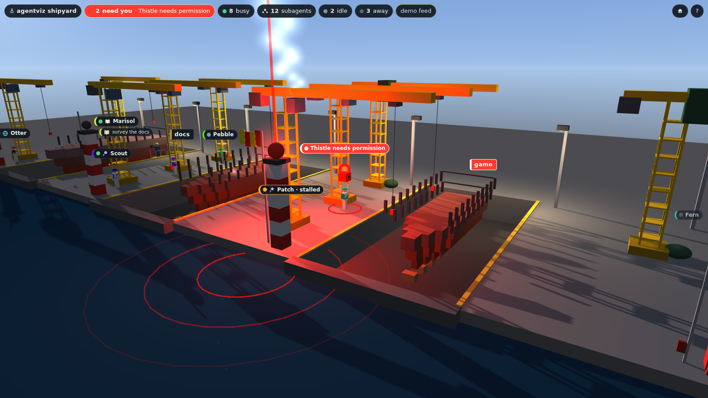

*`waiting`: Thistle is held at a permission prompt. Foghorn lamp, raised
flag, beam, ripples and a red padlock over the foreman.*

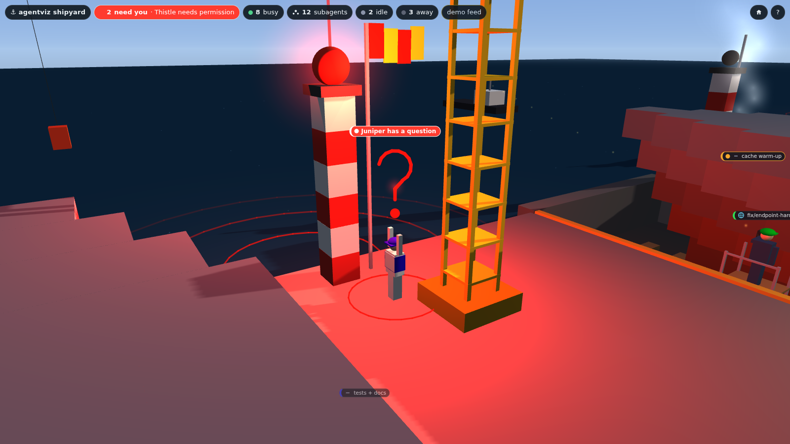

*Juniper waits on a question: a red "?" over the foreman, and the label says
so.*


*`idle` and `offline` at the home dock: Lantern stands by; Tally has gone, so
its crane cab and spot on the quay are tarped; Sparky taps a hammer (`other`).*

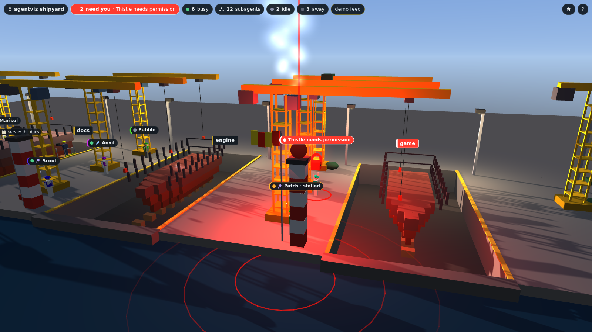

*`stalled`: Patch has been busy without writing anything for over five
minutes, so grey smoke rises from his crane cab beside a blinking amber lamp.*

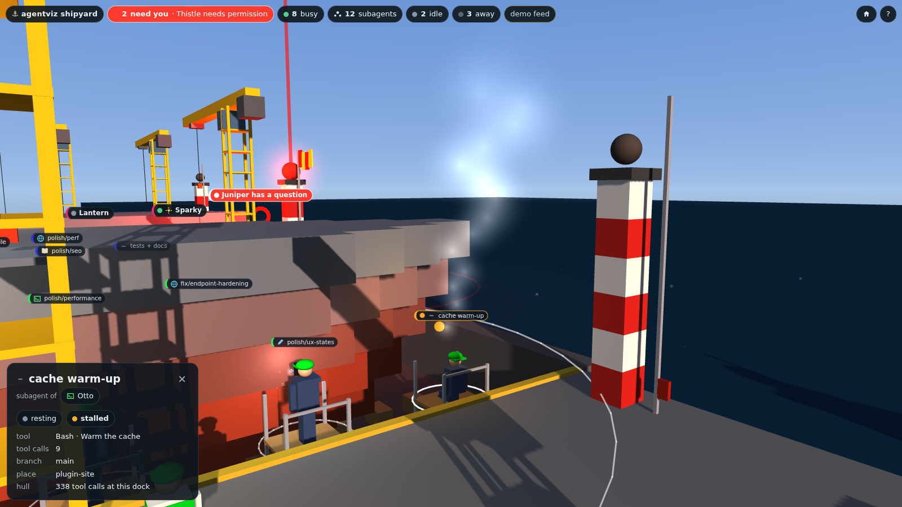

*A stalled subagent ("cache warm-up", quiet for over five minutes without
finishing): the same smoke and amber lamp, smaller, over its bay. Selected,
so it carries the white ring.*

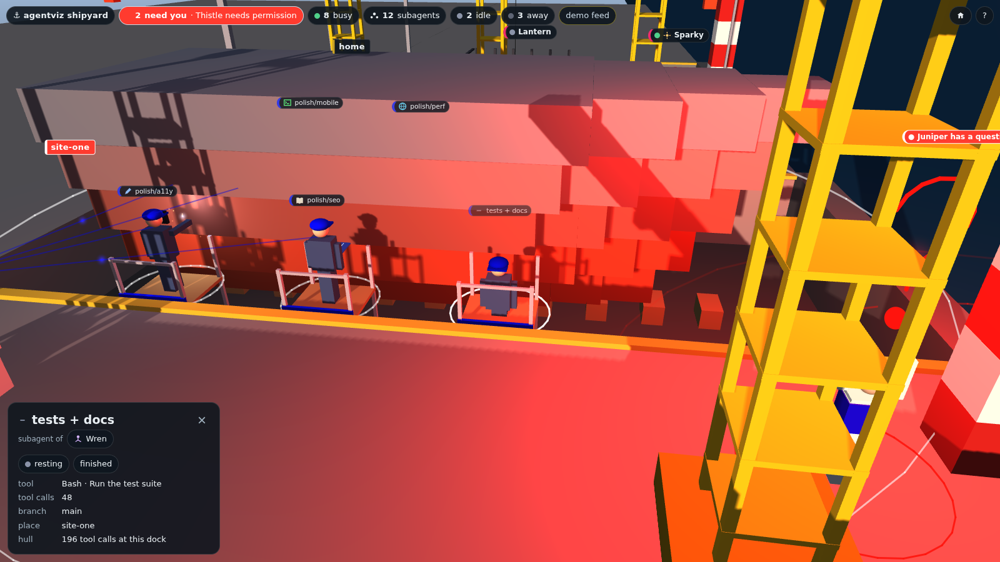

*A resting subagent, selected: Wren's `tests + docs` welder sits on the edge
of its bay while the other lanes work.*

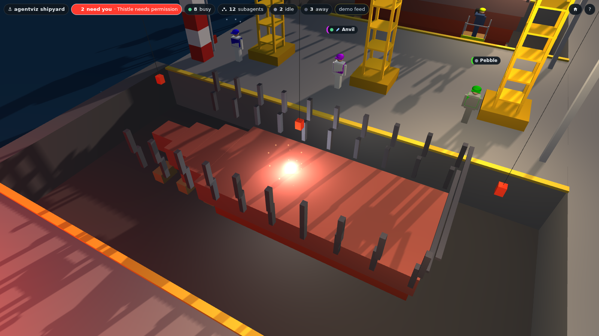

*A new tool call: a white flash and a ring of sparks where Anvil's crane
meets the hull (held at 70% strength for the still; live, it fades over about
a second).*


*Desktop: Otto selected; his welders are ringed too.*

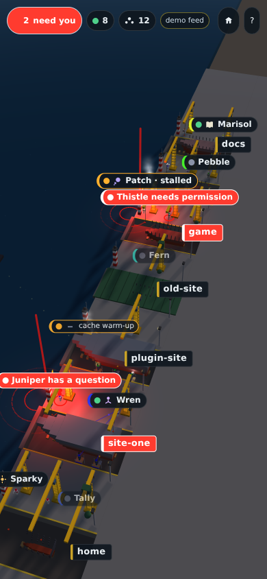 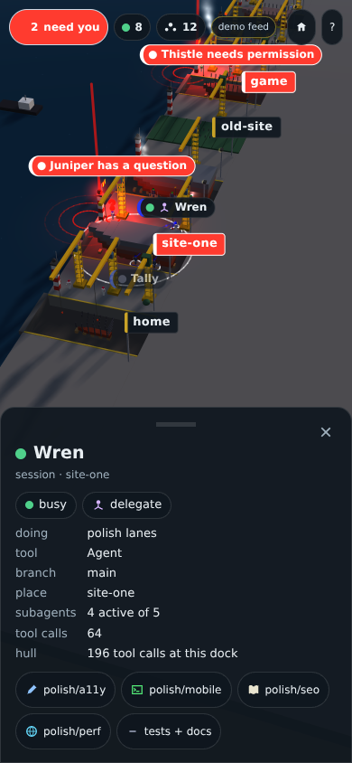

*Phone portrait (390 × 844, DPR 3). Left: held upright, the yard is seen
along the harbour so every dock fits, and the top bar keeps to one row.
Right: a tap on Wren opens her card as a bottom sheet and slides her into
view above it.*


*From the harbour, looking inland past the ship the signal lamps talk to.*

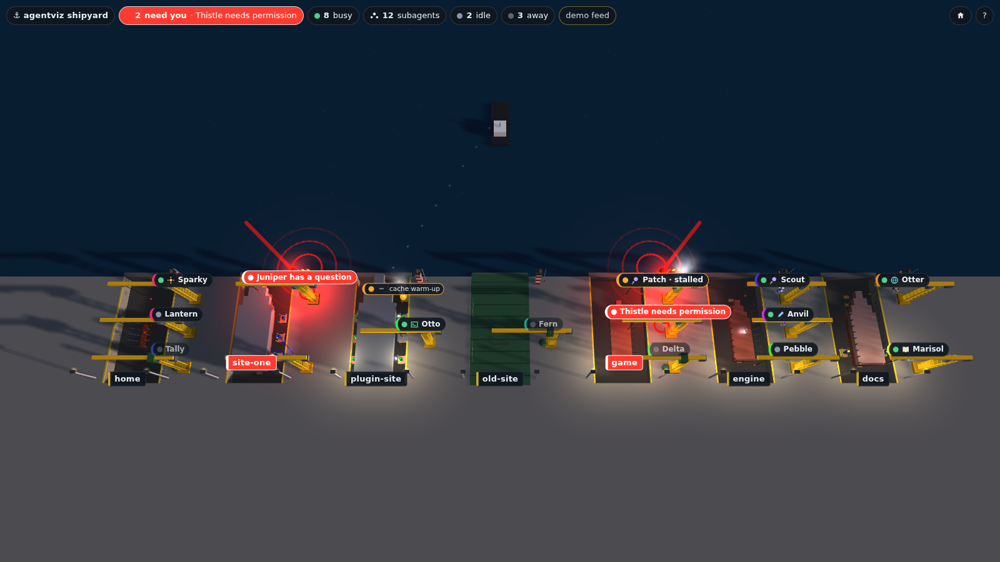

*From above: docks side by side, foremen on the quay beside each.*

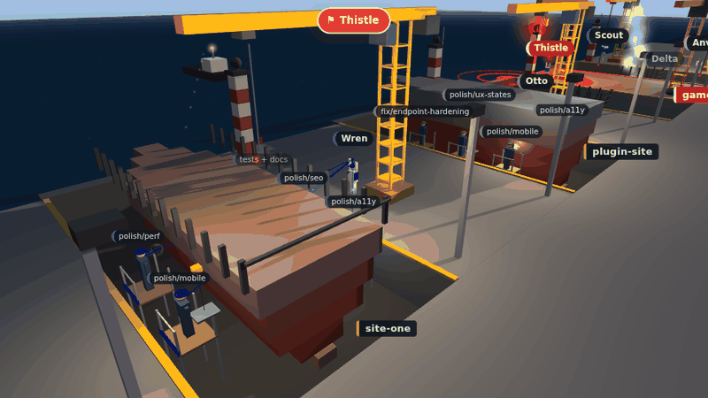

*Five seconds at the site-one dock: sparks, a chain hoist, a signal lamp and
Wren waving her crews on along the delegate lines.*

## Build and test

```bash
python3 -m unittest discover -s tests       # serves the fixture; page, assets, feed, vendored PINs
npm ci && npx playwright install chromium   # Playwright 1.61.1, for the browser tests
pip install -r requirements-dev.txt         # Pillow, for the GIF
npm run smoke                               # headless Chromium on the demo feed; saves docs/media/screenshot.png
npm run screenshots                         # every image above (or some: npm run screenshots -- hero phone phone-yard motion)
EMSDK=/path/to/emsdk vendor/agentviz-kit/scene/build-scene.sh scene/kit.conf   # rebuild web/shipyard-engine.*
```

The built engine files are committed, so serving needs only Python. The
browser tests use port 9125 (`SHIPYARD_TEST_PORT` overrides), the unit tests
port 9126 (`SHIPYARD_UNIT_PORT`). `vendor/agentfeed/`, `vendor/agentviz-kit/`
and `web/agentviz-*` come from
[agentviz](https://github.com/dmccoystephenson/agentviz) (`tools/vendor-kit.sh`);
do not edit them here.

## How it works

The feed client, the HUD (chips, the selected-agent card and bottom sheet,
the banner, the empty state), world labels, tap picking and the
page-to-engine data format are the shared agentviz kit (docs/KIT.md in
agentviz). On top of it, `web/shipyard-model.js` keys everything by id, lays
a dry dock per place along the harbour, a foreman per session on its quay and
a welder per subagent on a scaffold bay round the hull, and eases them
between snapshots. Each frame `web/shipyard-frame.js` packs the scene in the
agentviz wire format (docks as zones, foremen and welders as agents,
delegation lines as links); `scene/main.cpp` decodes it with `agentviz.h`
(`yard.h`) and draws the land, quays, sea and ship (`harbour.h`), the hulls,
floodlights and foghorn towers (`dock.h`) and the people and cranes
(`crew.h`, `person.h`, `signals.h`) with Strata's primitives, lines, points
and point lights.

## Licence

Code: [MIT](LICENSE). Screenshots and GIFs in `docs/media/`:
[CC0 1.0](LICENSE-media). The committed engine bundles Strata (MIT) and its
libraries, and the Emscripten runtime: see
[THIRD_PARTY_NOTICES.md](THIRD_PARTY_NOTICES.md).
